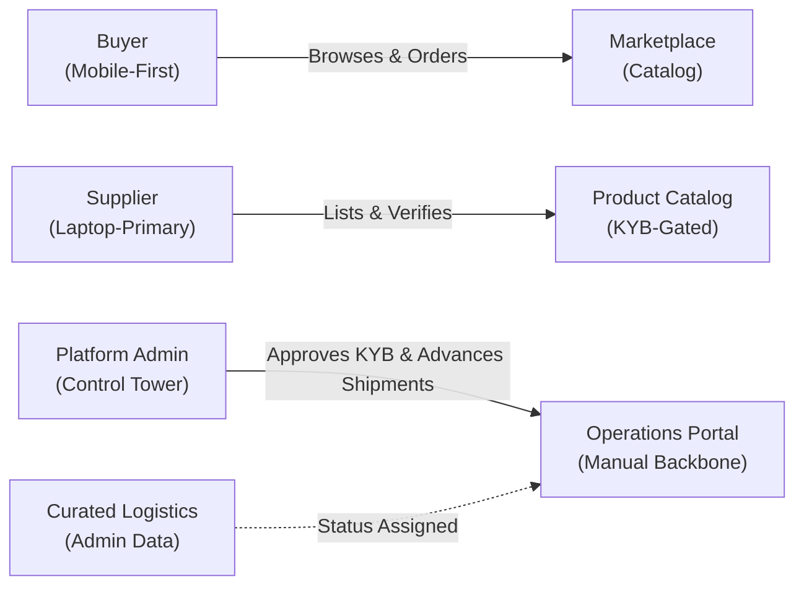

# AfriTrade Connect — Product Context & Design Brief

> **Authority & Source Citations**: `design/stitch/ANSWERS.md`, `README.md`, `SCOPE.md`, `ARCHITECTURE.md`, `docs/product/01-PRD.md`, `docs/product/03-App-Flow.md`.  
> **Status**: Approved Context Pack for Stitch UI Generation. Visual & brand parameters locked.

---

## 1. What the Product Is

**AfriTrade Connect** is a specialized B2B cross-border marketplace and curated logistics visibility platform engineered for intra-African commerce under the **African Continental Free Trade Area (AfCFTA)** framework (`docs/product/01-PRD.md §1`).

The platform addresses severe intra-African trade friction where small and medium-sized enterprises (SMEs)—such as agricultural producers, textile manufacturers, and wholesale distributors—currently rely on fragmented, informal channels (WhatsApp groups, unverified email threads, word-of-mouth) to source partners, navigate volatile foreign exchange, and coordinate freight (`docs/product/01-PRD.md §2`).

AfriTrade Connect replaces this fragmentation with a unified digital trade corridor connecting three launch markets:
1. **Nigeria (NG)** — Major industrial, manufacturing, and agricultural export hub (`apps/api/prisma/seed/data/reference.ts`).
2. **South Africa (ZA)** — Advanced agro-processing, industrial components, and southern regional gateway.
3. **Ghana (GH)** — Key West African trade hub, cocoa/commodities producer, and host of the AfCFTA Secretariat.

---

## 2. Platform Roles & Interface Jobs

AfriTrade Connect operates as a three-sided platform coordinated by a central administrative operator (`SCOPE.md`, `docs/product/01-PRD.md §5`):

### 2.1 The Buyer Interface
- **Primary Persona**: Commercial wholesale buyers, import-export merchants, retail chains, and procurement managers across Africa.
- **The Job of the Interface**:
  - Deliver rapid, frictionless product discovery across African borders with prominent search, country filters (`NG`, `ZA`, `GH`), and category filtering (`grains`, `raw-materials`, `textiles`, etc.).
  - Eliminate currency confusion through **dual-price transparency**: listings display the supplier’s home settlement currency alongside an indicative converted equivalent in the buyer's home currency.
  - Enable one-click order placement with immediate simulated payment completion.
  - Provide an intuitive, anxiety-reducing order tracker showing exactly where cross-border shipments stand in the logistics pipeline.
- **Platform Emphasis**: **Mobile-first** (`ANSWERS.md` Q3). Wholesale buyers in African markets operate predominantly from Android smartphones on variable mobile data networks.

### 2.2 The Supplier Interface
- **Primary Persona**: Verified African manufacturers, agricultural cooperatives, agro-processors, and licensed exporters.
- **The Job of the Interface**:
  - Guide business owners through business profile submission for **Know Your Business (KYB)** verification, clearly indicating verification stages (`NOT_SUBMITTED`, `PENDING`, `APPROVED`, `REJECTED`).
  - Gated product catalog management: Once approved, suppliers list and price bulk merchandise in their local operational currency (`NGN`, `ZAR`, `GHS`, or `USD`).
  - Provide an incoming order queue (`/supplier/orders`) where suppliers inspect buyer demand, track confirmed payments, and **advance preparation status** (`PAYMENT_CONFIRMED` ➔ `PREPARING` / `READY_FOR_PICKUP`), enabling proactive order fulfillment before administrative freight dispatch.
  - Track commercial health through simple metrics: active products, pending orders, and gross revenue broken down per individual currency.
- **Platform Emphasis**: **Laptop-primary, but fully responsive across all screen sizes (mobile to 4K)** (`ANSWERS.md` Q3). Factory managers and inventory clerks manage catalogs and business filings from mobile, tablet, or desktop browsers.

### 2.3 The Platform Admin Interface
- **Primary Persona**: AfriTrade Connect platform operators, compliance officers, and trade logistics managers.
- **The Job of the Interface**:
  - Act as the **operational backbone** for all manual workflows in the MVP prototype (`docs/product/03-App-Flow.md §4`):
    1. **KYB Verification Review**: Audit business credentials, company registration numbers, and tax declarations; issue `APPROVE` or `REJECT` decisions with mandatory recorded audit reasons (`RULES.md §4`).
    2. **Curated Logistics Partner Directory**: Maintain the master list of vetted regional freight carriers, sea/air lines, and haulage companies covering corridors.
    3. **Order & Shipment Control**: Oversee all cross-border orders, bind curated freight partners to confirmed orders, and advance shipment stages along the state machine (`LOGISTICS_ASSIGNED` ➔ `PICKED_UP` ➔ `IN_TRANSIT` ➔ `CUSTOMS` ➔ `DELIVERED`).
    4. **Platform Metrics**: High-density summary of active users by role, pending queues, total orders, and trade volume grouped by currency.
- **Platform Emphasis**: **Laptop-primary**, data-dense control tower (`ANSWERS.md` Q3, Q25).

---

## 3. Geographic Markets & Multi-Currency Engine

### 3.1 Countries as Reference Data (Not Code)
Per `RULES.md §7` and `ARCHITECTURE.md Rule 6`, countries and currencies are **never hardcoded enums in business code**. They are database reference records served dynamically via `GeoService`:
- **Nigeria**: ISO `NG`, Currency `NGN` (Nigerian Naira ₦), Primary corridor partner.
- **South Africa**: ISO `ZA`, Currency `ZAR` (South African Rand R), SADC regional trade hub.
- **Ghana**: ISO `GH`, Currency `GHS` (Ghanaian Cedi GH₵), AfCFTA Secretariat location.
- **International Trade**: Currency `USD` (US Dollar $), Standard pan-African trade benchmark.

### 3.2 Single-Currency Order Discipline
- **Rule**: Every product is priced in exactly one currency. An order contains items in one currency only (`SCOPE.md`, `RULES.md §1`).
- **Cart Rule**: Mixed-currency carts are structurally prohibited. Buyers settle in the supplier's stated listing currency.
- **No Float Currency Math**: Currency amounts are stored as exact decimal values/minor units; cross-currency arithmetic is forbidden. Totals are summed per currency and never combined into an artificial unified number (`RULES.md §1`, `§2`).

---

## 4. Simulated Payments Architecture (Zero-Cost Phase)

- **Simulated Provider (`MockPaymentProvider`)**: In this MVP phase, **zero real money moves** (`SCOPE.md`, `RULES.md §2`). All four launch currencies (`NGN`, `ZAR`, `GHS`, `USD`) are fully payable and automatically succeed through the mock provider interface.
- **No Blocked Currencies**: No currency is treated as inert or special-cased.
- **Mandatory UI Labelling**: Per `ANSWERS.md` Q30 and `RULES.md §2`, whenever `PAYMENTS_MODE=simulated`, all checkout buttons, order confirmations, and financial metric cards must carry a balanced, confidence-inspiring badge or subtitle:  
  `[Simulated Transaction — MVP Demo Mode]`  
  This prevents tester or panel confusion while verifying that the state machine, ledger entries, and order transitions execute identically to a live banking gateway.

---

## 5. Capstone Demo Context & Target Audience

### 5.1 Project Background
AfriTrade Connect is an academic capstone MVP developed by a solo engineer (`DevMyke` / Favour Okafor) on a 1-month timeline with a strict **zero infrastructure cost constraint** (`docs/product/01-PRD.md §1`, `SCOPE.md`).

### 5.2 The Evaluation Audience
Per `ANSWERS.md` Q9, the UI must perform for four distinct evaluators simultaneously:
1. **Academic Defense Panel**: Demands architectural rigor, visible enforcement of AfCFTA principles, clean data flow, and complete state machine transitions without unhandled edge cases.
2. **User Testers (30 Target Users)**: Require immediate clarity, high legibility, fast loading on African mobile networks, and intuitive navigation.
3. **Future Investors**: Require an enterprise-grade, defensible B2B product demonstration that proves market viability and looks commercially viable on Day 1.
4. **Platform Owner**: Demands high craftsmanship, anti-generic UX, and robust modularity ready for live payment switch-on.

---

## 6. Brand Personality, Emotional Tone & Aesthetic Mandates

Per `ANSWERS.md` Section B (Q7–Q9, Q14) and Section D (Q15–Q23), the interface must adhere to strict emotional and aesthetic guidelines:

### 6.1 What the Interface MUST Feel Like
- **Trustworthy & Authoritative**: B2B trade involves high-value cross-border consignments. Typography, borders, and structured badges must project security, institutional validity, and operational precision.
- **Industrial & Agricultural Grounding**: Reflects physical trade goods—grain silos, cocoa sacks, shipping containers, customs waybills, bulk tonnage.
- **Warm & Bold African Identity**: Rich agricultural emerald greens (`#0f6b4f`, `#047857`) paired with warm harvest golds (`#e8a317`, `#f59e0b`).
- **UX-Inclined & Standard**: Follows modern B2B best practices (clear visual hierarchy, predictable breadcrumbs, accessible contrast, 44px minimum touch targets).
- **Production-Ready & Intentional**: Not a superficial hackathon prototype or a hasty hobby project.

### 6.2 What the Interface MUST NEVER Feel Like
- **NOT an AI-Generated Template**: No generic gradient blobs, no floating three-column feature cards with generic placeholder copy, no centered-everything landing page clichés.
- **NOT a Consumer E-Commerce Store**: This is NOT a consumer boutique (B2C) selling individual consumer shirts or sneakers. It is a wholesale B2B trade desk dealing in commercial lots, minimum order quantities (MOQ), metric tonnes, pallets, and export crates.
- **NOT Culturally Clichéd or Offensive**: Strict ban on stereotyped African tropes (safari animals, tribal pattern borders, mud hut motifs). The visual language is modern, industrial, and urban pan-African commerce (`ANSWERS.md` Q14).
- **NOT Vibe-Coded or Over-Engineered**: Clean, predictable components without distracting animations, excessive 3D canvases, or cryptic navigational models.
