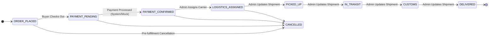

# AfriTrade Connect — Domain UI Rules & Integrity Invariants

> **Authority & Source Citations**: `.agents/rules/RULES.md` (§1–§7, §10–§12, §21–§23), `SCOPE.md`, `AGENTS.md`, `design/stitch/ANSWERS.md` (Q4, Q5, Q28, Q30, Q31).  
> **Status**: Non-negotiable platform rules. Every UI generated by Stitch must strictly enforce these constraints.

---

## 1. Money & Multi-Currency Rules (RULES §1)

### 1.1 Decimal Storage & Display Formatting (`Conflict 4 resolved`)
- **Core Invariant**: All monetary values are maintained in the database as Postgres `Decimal(14, 2)` (`schema.prisma`) and travel across API boundaries as **decimal strings** paired with explicit ISO currency codes (e.g., `{ amount: "12500.00", currency: "NGN" }`), completely eliminating JavaScript floating-point representation bugs.
- **Single Formatter**: Currency formatting is handled exclusively via the shared utility `formatMoney` (`packages/shared/src/types/money.ts`). Components must never concatenate currency symbols or format floats ad-hoc.
- **Never Cross-Sum Currencies**: Currencies are **never added, averaged, or converted into an artificial composite total**.
  - On dashboards (Buyer, Supplier, Admin), trade volume and spend are displayed as **separate grouped figures per currency**:
    - `Spend: ₦1,250,000 NGN  ·  R 45,000 ZAR  ·  GH₵ 12,000 GHS  ·  $3,500 USD`
  - Summing across currencies into a single number is an explicit platform bug (`RULES.md §1`, `§2`).

### 1.2 Single-Currency Order Discipline
- An order contains items in **one currency only**.
- Mixed-currency carts or orders are structurally rejected by the domain layer (`ORDER_CROSS_CURRENCY_REJECTED`).
- Settlement occurs strictly in the supplier's listed currency.

---

## 2. Dual-Price Display & Indicative Conversion Copy (ANSWERS Q31, RULES §1)

### 2.1 The Two-Line Price Standard
Every product listing card (`ProductCard.tsx`) and product detail page (`/marketplace/[id]`) must display pricing using the two-line standard:
1. **Primary Line (Listed Supplier Currency)**:
   - Rendered in bold, prominent type. This is the **legally authoritative settlement price**.
   - Example: **`GHS 150.00 / 50kg bag`**
2. **Secondary Line (Indicative Viewer Currency)**:
   - Displayed smaller, in muted neutral text (`--color-text-muted` / `text-muted-foreground`), only when the viewer's preferred currency differs from the supplier's listed currency.
   - Exact copy format (`ANSWERS.md` Q31):  
     **`≈ NGN 15,000 (indicative)`**
   - Accompanied by an info tooltip or tap-sheet containing the exact owner-approved explanation:  
     `"Billed in supplier currency. Converted price is indicative only."`

---

## 3. Simulated Payment Labelling (ANSWERS Q30, RULES §2)

### 3.1 Balanced Prominence Labelling
In this MVP phase, `PAYMENTS_MODE=simulated` is enforced across all environments (`RULES.md §9`, `SCOPE.md`).
- **Visual Standard**: All checkout triggers, payment modals, and financial summary cards must carry a visible, balanced badge or subtitle:  
  `[Simulated Transaction — MVP Demo Mode]`
- **Tone**: Balanced prominence—clearly visible to prevent legal or evaluator misunderstanding, but styled calmly without alarmist warning colors (`ANSWERS.md` Q30).
- **No Mixing Real and Simulated Data**: Historical MOCK payments are flagged with `provider = MOCK`. If any live payment provider is introduced in future phases, mock transactions must remain segregated (`RULES.md §2`).

---

## 4. Order State Machine & Stepper Requirements (RULES §12, §22)

### 4.1 The Canonical Order Lifecycle
The order state machine is closed and immutable (`packages/shared/src/types/enums.ts`):

### 4.2 Transition Authorization Architecture (`Conflict 5 resolved`)
- **System/Payment-Driven**:
  - `ORDER_PLACED` ➔ `PAYMENT_PENDING` ➔ `PAYMENT_CONFIRMED`
  - Admin cannot manually advance an order into or out of payment states (`RULES.md §12`).
- **Supplier-Driven (Operational Fulfillment)**:
  - `PAYMENT_CONFIRMED` ➔ `PREPARING` / `READY_FOR_PICKUP`
  - Suppliers advance preparation milestones once payment is confirmed to signal readiness for logistics.
- **Admin-Driven (`ADMIN_SHIPMENT_TRANSITIONS`)**:
  - `PAYMENT_CONFIRMED` / `READY_FOR_PICKUP` ➔ `LOGISTICS_ASSIGNED` ➔ `PICKED_UP` ➔ `IN_TRANSIT` ➔ `CUSTOMS` ➔ `DELIVERED`
  - Only platform administrators can assign freight partners or advance logistics and customs stages.

### 4.3 Tracker Visual Standard (Standing Rule §22)
- **Phase 1 (Current)**: **Horizontal Stepper** displaying all 8 canonical milestones.
- **Handling `CANCELLED`**: The stepper must distinctly handle the `CANCELLED` status with a clear red status alert pill, timestamp, and cancellation notice (`RULES.md §12`).
- **Future Evolution**: At the first major launch, the tracker evolves to a **map-like geographic corridor view** (`RULES.md §22`, `ANSWERS.md` Q28). The underlying status data model (`ORDER_STATUS_TRANSITIONS`) remains identical so the visual layer can swap without touching backend logic.

---

## 5. KYB Verification States & Role Visibility (RULES §3, SCOPE)

### 5.1 The Four KYB States
Suppliers exist in one of four strictly typed states (`KybStatus`):
1. `NOT_SUBMITTED`: Registered account with no business documentation on file.
2. `PENDING`: Business details submitted; awaiting manual admin review.
3. `APPROVED`: Verified African enterprise. Full product catalog publishing unlocked.
4. `REJECTED`: Submission rejected by compliance admin; holds mandatory audit reason.

### 5.2 Role-Specific Visibility Matrix

| Role | `NOT_SUBMITTED` | `PENDING` | `APPROVED` | `REJECTED` |
| :--- | :--- | :--- | :--- | :--- |
| **Buyer** | Supplier cannot list products (invisible) | Supplier cannot list products (invisible) | Sees verified badge on listings (`Verified Supplier`) | Supplier cannot list products (invisible) |
| **Supplier** | Persistent yellow warning banner: "Complete verification to list products" | Blue info banner: "Filing under review by compliance team" | Green badge: "Verified Supplier" + "+ Add Product" enabled | Red alert showing `kybRejectReason` + "Update Filing" CTA |
| **Admin** | Unlisted in review queue | Visible in KYB Review Queue with "Review & Decide" trigger | Marked as Verified in Suppliers Directory | Marked as Rejected in Suppliers Directory with logged audit reason |

---

## 6. Role Permissions & Operational Gating (RULES §12, SCOPE)

- **Suppliers Advance Preparation Milestones on Orders (`Conflict 5 resolved`)**:
  - Once an order reaches `PAYMENT_CONFIRMED`, suppliers are authorized to update operational preparation stages (`PAYMENT_CONFIRMED` ➔ `PREPARING` / `READY_FOR_PICKUP`).
  - This allows suppliers to signal to the buyer and platform coordinators that goods are packaged, verified against the invoice lot, and ready for freight collection.
- **Admin Coordinates Cross-Border Freight & Customs (`ADMIN_SHIPMENT_TRANSITIONS`)**:
  - Logistics partner assignment, carrier dispatch, customs clearance advancement, and delivery confirmation remain exclusively controlled by platform administrators in `apps/admin`.
- **KYC is a Non-Functional Placeholder**:
  - `apps/admin/src/app/users/kyc` must render as a static, non-functional placeholder marked "Coming soon" (`RULES.md §23`, `ANSWERS.md` Q5, Q9). Zero upload forms, zero mock verification APIs.

---

## 7. Error Handling & Taxonomy (RULES §10, §11)

- **Strict Domain Error Codes**:
  - The UI must **never display raw HTTP exception names** (e.g., `BadRequestException`, `HttpException`) or generic strings (`"ERROR"`, `"FAILED"`, `"Something went wrong"`).
  - Every failure state in the UI must map from a canonical `ErrorCode` enum in `@afritrade/shared` (`DOMAIN_ENTITY_REASON` format in `SCREAMING_SNAKE_CASE`):
    - `AUTH_INVALID_CREDENTIALS` ➔ "Invalid corporate credentials."
    - `CATALOG_SUPPLIER_NOT_VERIFIED` ➔ "Business verification required prior to listing."
    - `ORDER_CROSS_CURRENCY_REJECTED` ➔ "Orders cannot combine multiple currencies."
    - `SHIPMENT_INVALID_TRANSITION` ➔ "Invalid shipment advancement."

---

## 8. Language & Extraction Constraints (RULES §7)

- **English Only**: The MVP interface is strictly in English.
- **No Concatenation Blocking**: User-facing copy must avoid runtime string concatenations that make future extraction into localization dictionaries painful (e.g. avoid `"Order " + id + " was " + status`). Use template strings with complete sentence structure.
