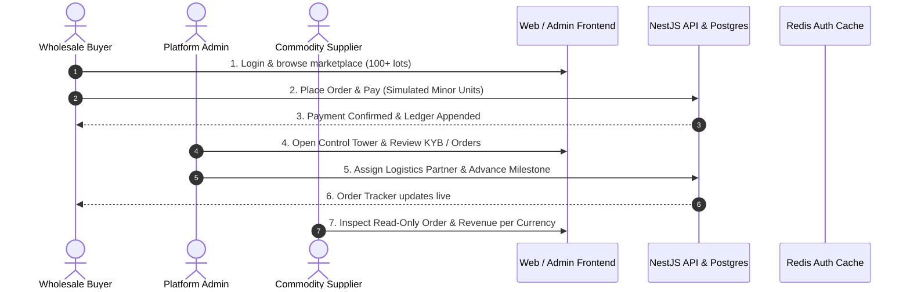

# AfriTrade Connect — Capstone Defense Demonstration Script & Walkthrough

## 1. Overview & Defense Timing (12-Minute Target)

This document provides the definitive, chronological script for presenting and demonstrating **AfriTrade Connect** during the capstone defense. The presentation demonstrates a working, end-to-end multi-persona trade lifecycle across Nigeria, South Africa, and Ghana.

---

## 2. Segment 1: Academic & Architectural Introduction (2 Minutes)

### Speaker Script:
> "Good morning, members of the evaluation committee. Today, I am presenting **AfriTrade Connect**, a three-sided B2B intra-African trade marketplace designed to remove cross-border trade friction between West and Southern Africa.
>
> In Africa today, cross-border trade accounts for less than 17% of total continental trade, hampered by three fundamental roadblocks:
> 1. **Currency fragmentation & payment settlement friction** across local currencies (NGN, ZAR, GHS).
> 2. **Lack of verifiable cross-border counterparty trust** (KYB compliance).
> 3. **Logistics opacity** and lack of tracking.
>
> To solve this within the scope of our capstone, AfriTrade Connect was architected under five non-negotiable engineering principles:
> - **Zero Infrastructure Cost**: Built entirely with production-grade open-source tools (Docker, Postgres, Redis, Next.js, NestJS) operating on free tiers.
> - **Strict Financial Integrity**: Every monetary amount is stored as an integer in the currency's minor unit (kobo, pesewas, cents). No floating-point math, no cross-currency addition, and all transactions are recorded to an immutable, append-only ledger.
> - **Pluggable Provider Abstraction**: In this MVP phase, payment processing is simulated via `MockPaymentProvider` while preserving the exact database and ledger schemas required for live Paystack and Flutterwave integrations in Phase 1.
> - **Defense-in-Depth Authentication**: Access tokens are 15-minute JWTs held strictly in JavaScript memory (zero web storage vulnerability), backed by 7-day HttpOnly refresh cookies with cryptographic SHA-256 rotation and automatic breach detection in Redis.
> - **Clean Architecture**: 3-tier unidirectional data flow (Component $\to$ Hook $\to$ API Function $\to$ Server) and schema-first validation using Zod."

---

## 3. Segment 2: Wholesale Buyer Journey (3 Minutes)

### Demo Actions:
1. **Open Buyer Web App (`apps/web`)**: Navigate to `http://localhost:3000/login`.
2. **Log In as Buyer**:
   - Email: `buyer@afritrade.test`
   - Password: `Password123!`
3. **Marketplace Discovery (`/marketplace`)**:
   - Showcase the catalog containing over 100 seeded commodity lots.
   - Apply filters: Select **Country: Nigeria** and **Category: Agriculture**.
   - Inspect a lot: Click into *Sorghum Grain Lot* (`/marketplace/[id]`).
   - Point out: Verified supplier badge, minimum order quantity (MOQ), and transparent pricing in NGN.
4. **Order Placement & Simulated Instant Payment**:
   - Select quantity: 10 metric tons.
   - Click **Order & Pay Now**.
   - Observe instantaneous execution: `MockPaymentProvider` processes the order, writes an append-only ledger entry with idempotency protection, and redirects to the order details screen.
5. **Horizontal Order Stepper (`/orders/[id]`)**:
   - Point out the active status: `PAYMENT_CONFIRMED`.
   - Explain that the horizontal stepper provides clear visual milestones (`ORDER_PLACED` $\to$ `PAYMENT_CONFIRMED` $\to$ `LOGISTICS_ASSIGNED` $\to$ `PICKED_UP` $\to$ `IN_TRANSIT` $\to$ `CUSTOMS` $\to$ `DELIVERED`).

---

## 4. Segment 3: Platform Administrator Operations Control Tower (4 Minutes)

### Demo Actions:
1. **Open Admin Console (`apps/admin`)**: Navigate to `http://localhost:3031`.
2. **Log In as Admin**:
   - Email: `admin@afritrade.test`
   - Password: `Password123!`
3. **Platform Overview Dashboard (`/`)**:
   - Point out the **Operations Control Tower**:
     - Live counts: Registered Buyers, Verified Suppliers, Active Lots.
     - **Trade Volume (Simulated)**: Displayed cleanly broken down per currency (NGN, ZAR, GHS, USD) with zero cross-currency mixing.
     - **Order Lifecycle Pipeline Bar**: The newly built segmented progress bar showing distribution of orders across active fulfillment stages.
4. **Supplier KYB Verification Queue (`/kyb`)**:
   - Review pending compliance submissions.
   - Demonstrate the audit trail: when an administrator approves or rejects a supplier, an immutable entry is written to `admin_audit_logs` with admin ID, timestamp, and decision reason.
5. **Logistics Partner Management (`/logistics`)**:
   - View curated regional freight partners (e.g., GIGX Cross-Border, DHL Africa West, Kobo360).
6. **Order Fulfillment Oversight & State Transitioning (`/orders`)**:
   - Select the buyer's newly placed order.
   - Step 1: Assign a logistics carrier (e.g., *DHL Global Forwarding West Africa*). Status transitions to `LOGISTICS_ASSIGNED`.
   - Step 2: Step through `PICKED_UP` $\to$ `IN_TRANSIT`.
   - Highlight the **State Machine Enforcement**: Show that illegal transitions (such as skipping directly to `DELIVERED` or attempting to cancel an in-transit shipment) are rejected by server-side validation.

---

## 5. Segment 4: Commodity Supplier Experience (2 Minutes)

### Demo Actions:
1. **Log In as Supplier**:
   - Navigate to `http://localhost:3000/login`.
   - Email: `supplier@afritrade.test`
   - Password: `Password123!`
2. **Supplier Dashboard (`/dashboard`)**:
   - Highlight the **KYB Status**: Shows verified badge (`APPROVED`).
   - Highlight **Revenue per Currency**: Clearly shows earnings partitioned by currency (e.g., NGN 4,500,000 / ZAR 85,000).
   - Highlight **Incoming Orders Oversight**:
     - The supplier sees the order placed by the buyer.
     - Point out the key architecture rule: **Incoming orders are strictly read-only for suppliers in the MVP** to eliminate state synchronization conflicts. All fulfillment transitions are governed by the platform admin.
3. **Inventory & Product Lot Management (`/products`)**:
   - Show active lots, stock levels, and demonstrate the product lot creation form (`/products/new`) with integer minor-unit pricing.

---

## 6. Segment 5: Technical Defense Q&A Key Points (1 Minute)

Be prepared to answer technical questions with these specific references:

| Potential Evaluator Question | Architectural Defense Response |
| :--- | :--- |
| **"Why not use live Paystack or Flutterwave now?"** | Per `SCOPE.md`, the MVP is scoped to validate marketplace dynamics, trust, and order state machines with zero transaction risk. We implemented a clean `PaymentProvider` adapter interface. In Phase 1, switching a currency to live Paystack requires changing one row in the `currencies` table and setting `PAYMENTS_MODE=live`. Orders and ledger code require zero modifications. |
| **"How do you handle floating-point rounding errors?"** | We completely banned floating-point decimals. Every amount is an integer in the minor unit (kobo, pesewas, cents) represented as `BigInt` in PostgreSQL and safe integers in the shared Zod DTOs. Derivation to major units occurs only at display. |
| **"How is authentication secured against token theft?"** | We use a hybrid token architecture. Access tokens live only in memory (15m expiry). Refresh tokens are 7-day opaque tokens in HttpOnly, SameSite=Strict cookies. Refresh tokens are hashed (SHA-256) and tracked in Redis by family ID. If a stolen token is reused, the entire token family is immediately revoked. |
| **"How does the frontend avoid stale data or race conditions?"** | Ad-hoc `fetch` or `useAsync` calls in `.tsx` components are strictly prohibited. All data flows through TanStack React Query via `@afritrade/hooks`. Mutations automatically invalidate query caches, ensuring consistency. |
