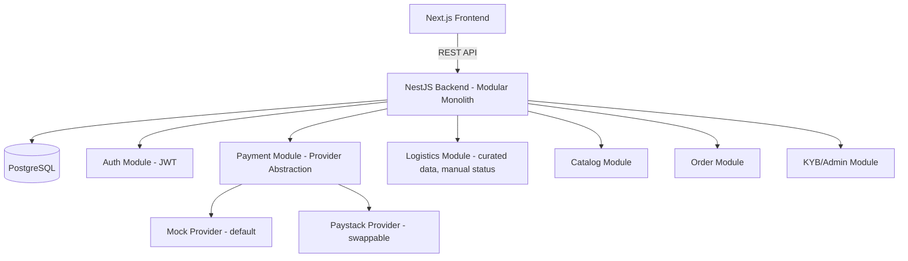

# AfriTrade Connect — Technical Requirements Document (TRD)

**Companion to:** 01-PRD.md
**Build constraint:** Solo developer, 1 month, zero infrastructure cost

---

## 1. Architecture Overview

**Style:** NestJS modular monolith. A monolith is the right call here — microservices would add operational overhead (service discovery, inter-service auth, multiple deployments) that a solo developer on a 1-month budget cannot absorb, and dozens of transactions/month don't need distributed infrastructure. Modules are still cleanly bounded so pieces can be extracted later if Phase 1 demands it.



## 2. Stack Decision (simplified from the earlier general-architecture recommendation)

The original recommendation (NestJS + Next.js + PostgreSQL + MongoDB + Redis + Docker) was scoped for a platform with real scale and budget. Given the **zero-infrastructure-cost constraint** and dozens-of-transactions/month reality, this MVP drops MongoDB, while scoping Redis strictly to auth token security (rotation and reuse detection):

- **MongoDB** was recommended for flexible catalog schemas at scale — not needed for ~100 seeded products with a fixed, simple schema. One relational `products` table is simpler to build, query, and seed.
- **Redis** is used strictly for auth token caching, rotation, and instant revocation (runs locally via Docker `redis:7-alpine` or free tier like Upstash with zero cost).

| Layer | Choice | Why |
|---|---|---|
| Frontend | Next.js (React) | Matches existing stack; free-tier hosting on Vercel |
| Backend | NestJS (TypeScript) | Matches existing stack; modular, testable |
| Database | PostgreSQL (single instance) | Relational integrity for users/orders/payments; free tier via Neon or Supabase |
| Cache / Session | Redis (local Docker / Upstash free tier) | Refresh token rotation, breach reuse detection, sub-ms session invalidation |
| ORM | Prisma | Clean schema-first modeling, type-safe, fast to iterate solo |
| Auth | Hybrid JWT + Opaque Refresh Token | 15m in-memory access token + 7d HttpOnly cookie + Redis rotation |
| File storage (product images) | Cloudinary or Supabase Storage free tier | No paid S3 bucket needed |
| Hosting (backend) | Render or Railway free web service | Zero cost for low-traffic demo |
| Hosting (frontend) | Vercel free tier | Zero cost, native Next.js support |
| Local dev | Docker Compose (Postgres + Redis) | Zero-cost local dev environment |
| CI | GitHub Actions free tier (optional) | Lint/type-check on push |

> **Note:** Free-tier services typically spin down on inactivity and have cold-start delays — acceptable for a demo/defense context, not something to design around further right now.

## 3. Payment Architecture — Provider Abstraction

This is the most important technical decision in the TRD, directly driven by the "zero infra cost, no delay" requirement.

```typescript
interface PaymentProvider {
  initiatePayment(order: Order): Promise<PaymentInitResult>;
  verifyPayment(reference: string): Promise<PaymentStatus>;
}

class MockPaymentProvider implements PaymentProvider {
  // Instantly marks payment as "successful" with a generated reference.
  // No external API call, no account/API key required, zero cost.
}

class PaystackProvider implements PaymentProvider {
  // Real NGN integration — implemented but toggled off by default via env flag.
}
```

- A `PAYMENT_PROVIDER=mock|paystack` environment variable selects the active provider at runtime — **no code changes needed to go live later**, only a config flip once a Paystack account is ready.
- The `Payment` entity stores `provider`, `reference`, `status`, `currency`, `amount` — identical shape regardless of which provider wrote it, so no migration is needed when switching.
- Build and demo with `mock` by default. If there's spare time in the schedule, wire up the real Paystack sandbox (still free) as a bonus — but it is **not a blocker** for any deliverable.

## 4. Logistics Architecture — Curated, Manual

- `LogisticsPartner` is a simple admin-managed table (name, country coverage, contact info) — seeded with the real partner names already identified, with no API credentials or integration code.
- `Shipment` holds a `status` enum updated manually by an admin through a simple dropdown/action in the admin dashboard: `PENDING → PICKED_UP → IN_TRANSIT → CUSTOMS → DELIVERED`.
- This is intentionally designed as a drop-in point: Phase 1 can replace the manual status update with a real carrier webhook/API call without changing the `Shipment` schema or the buyer/supplier-facing UI.

## 5. Multi-Country / Multi-Currency Readiness

- `Country` and `Currency` are data, not hardcoded enums baked into business logic — stored as reference tables (`countries`, `currencies`) seeded with Nigeria/NGN, South Africa/ZAR, Ghana/GHS, plus USD.
- Every business entity that needs it (`Order`, `Product`, `Payment`) references currency by foreign key, not a hardcoded string — adding a new country later is a data-seeding task, not a code change.
- Only NGN is wired to an actual (mock, then real Paystack) payment flow; ZAR/GHS/USD exist in the data model and UI selectors but are inert for now — this satisfies "easily scalable to add new countries" without doing extra build work today.

## 6. Design & Content Editability (for future team handoff)

Per the confirmed requirement that design work falls solely on the solo developer now but must be easy for a team to edit later:

- UI copy, branding colors, and static page content (About, How It Works, etc.) are pulled from a single `site-config` source (a structured JSON/TS config file or a lightweight `site_settings` database table) rather than hardcoded across components.
- Component structure follows a clear design-token pattern (colors/spacing/typography as variables) so a future designer can restyle without touching business logic.
- This is a documentation and structure discipline, not new infrastructure — zero added cost.

## 7. Security & Non-Functional Requirements

- JWT-based auth with role guards (`Buyer`, `Supplier`, `Admin`) enforced at the controller level via NestJS guards/decorators.
- Input validation via `class-validator` DTOs on every endpoint.
- Passwords hashed with bcrypt.
- Basic rate limiting on auth endpoints (`@nestjs/throttler`, free, no external service).
- No PII beyond what's needed for KYB (business name, country, contact) — no sensitive document storage required since KYB is manual admin review, not document-verification-API-driven.
- Logging: console/structured logs only — no paid logging service needed at this scale.

## 8. Explicitly Deferred (Phase 1 Technical Work)

- Real Paystack (and Flutterwave) live integration behind the existing abstraction
- Escrow state machine (hold → release) layered onto the `Payment` entity
- Real logistics carrier API adapters replacing manual status updates
- Redis-backed caching/queueing once transaction volume justifies it
- MongoDB (or similar) only if catalog complexity genuinely outgrows a relational model
- CMS/admin-editable content tooling built out from the `site-config` foundation laid now
