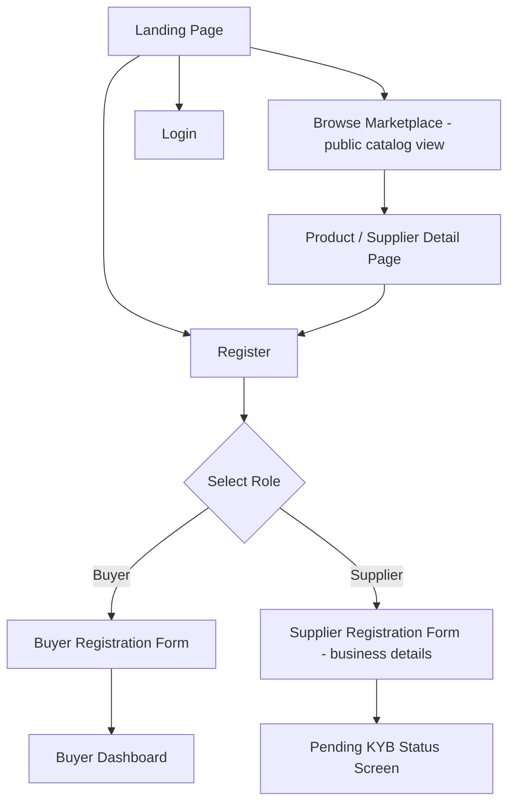
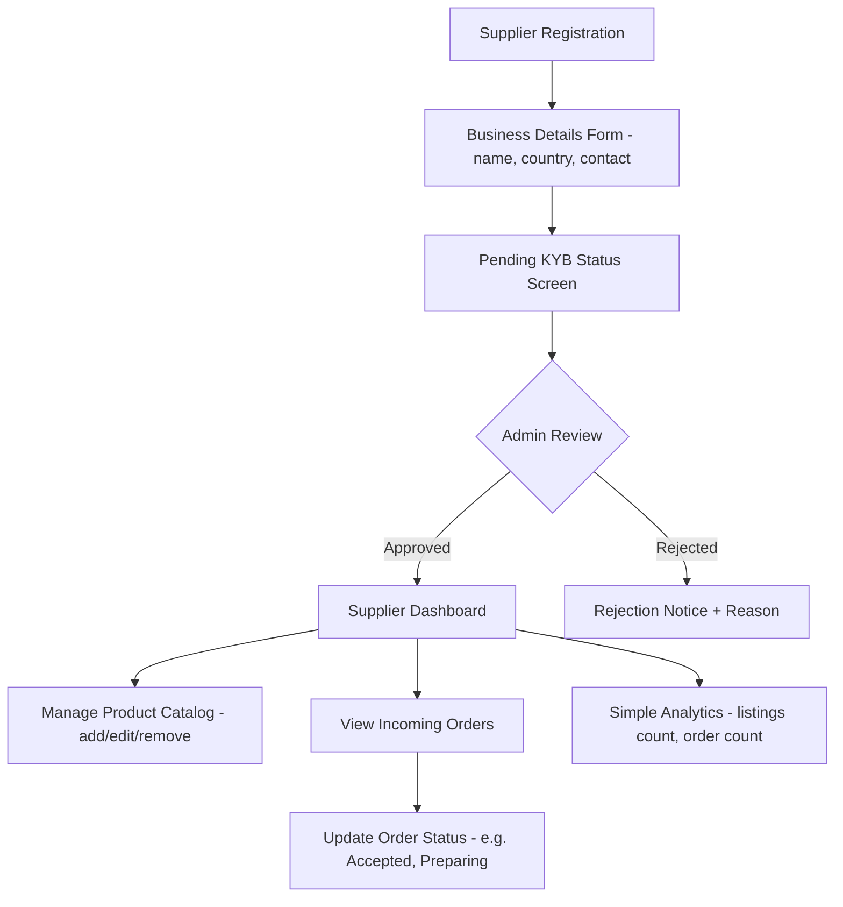
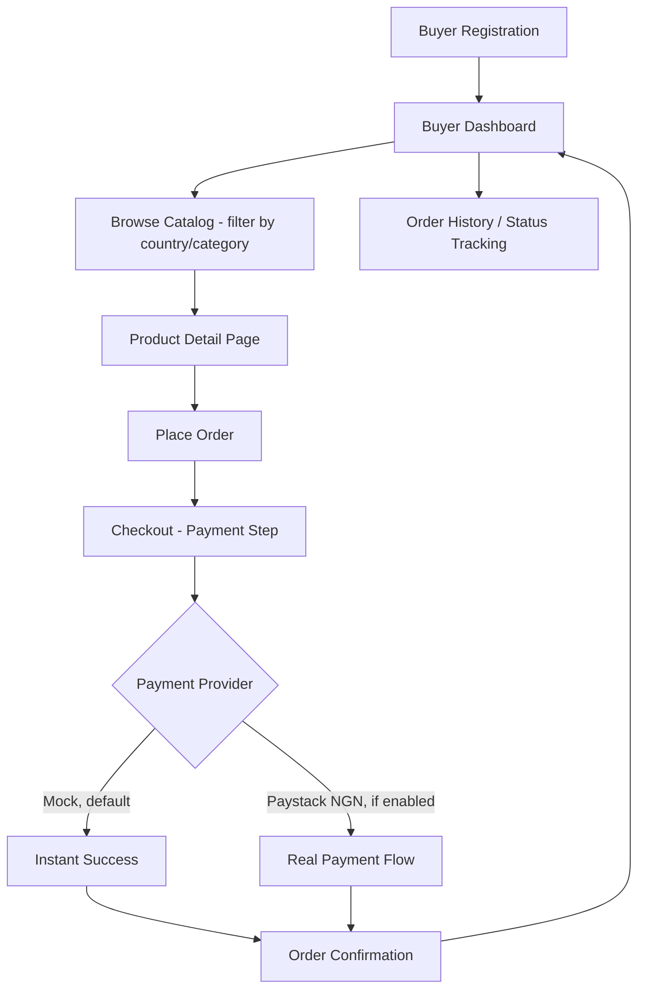
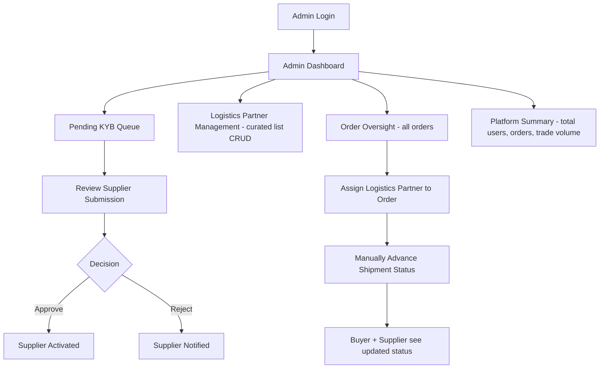
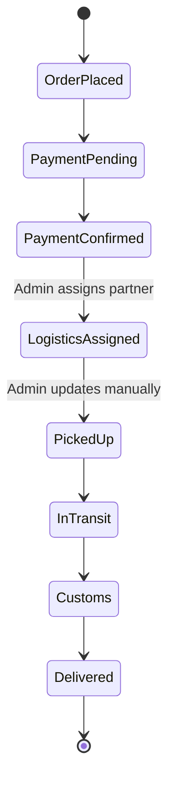

# AfriTrade Connect — Web App Flow

**Companion to:** 01-PRD.md, 02-TRD.md
**Platform:** Web app (responsive, desktop-first for demo/defense context)

---

## 1. Global / Public Flow (Unauthenticated)

- Landing page communicates the value proposition and links straight into a public, browsable product catalog — evaluators should be able to see the marketplace without logging in.
- Registration asks the user to select a role up front (Buyer or Supplier); Admin accounts are not self-registrable — seeded directly for the prototype.

## 2. Supplier Flow

- Supplier cannot list products until KYB status is `APPROVED` — enforced at the API level, not just hidden in the UI.
- Supplier dashboard stays intentionally simple: product list, order list, a couple of summary numbers. No advanced analytics in MVP.

## 3. Buyer Flow

- Checkout uses whichever `PaymentProvider` is active per the TRD's provider-abstraction design — the buyer-facing UI is identical either way.
- Buyer dashboard is simple: active orders with current shipment status, past orders, basic profile info.

## 4. Admin Flow

- Admin is the operational backbone of the MVP: every piece of "automation" the real platform will eventually have (verification, logistics API, payment processing) is a manual admin action in this prototype.
- Logistics partner management is simple CRUD on the curated list — no integration, no credentials.

## 5. Order Lifecycle (Cross-Role State Machine)

- This single state machine drives what the Buyer sees (order status), what the Supplier sees (order status), and what the Admin controls (status transitions) — one source of truth across all three dashboards.

## 6. Navigation Summary by Role

| Role | Primary Nav Items |
|---|---|
| Public | Home, Browse Marketplace, Login, Register |
| Buyer | Dashboard, Browse Marketplace, My Orders, Profile |
| Supplier | Dashboard, My Products, Incoming Orders, Profile/KYB Status |
| Admin | Dashboard, KYB Queue, Logistics Partners, All Orders, Platform Summary |
