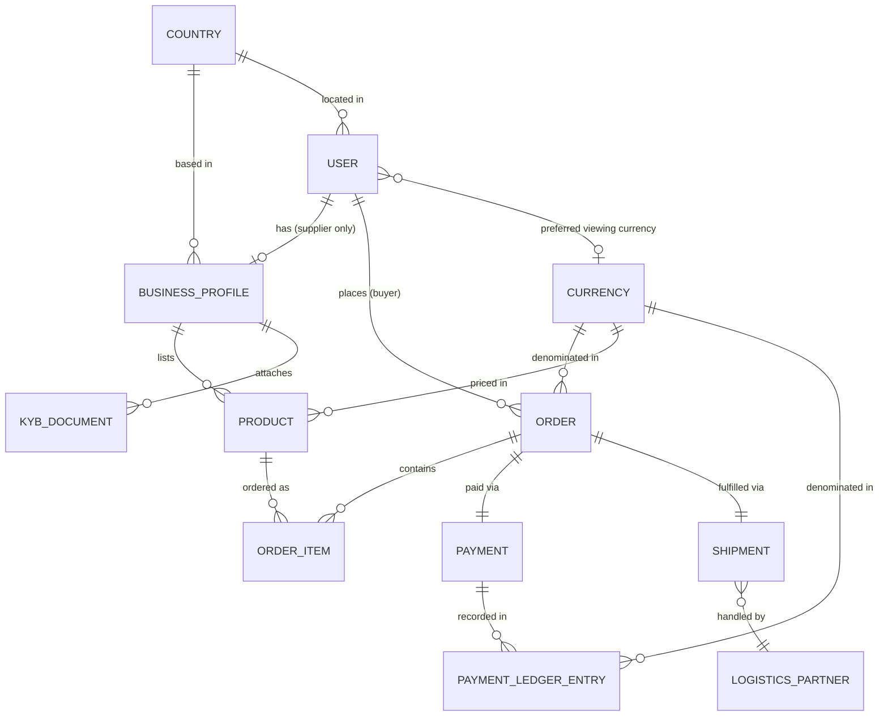

# AfriTrade Connect — Backend Schemas

**Companion to:** 02-TRD.md
**ORM:** Prisma (PostgreSQL) — maps 1:1 to TypeORM entities if preferred later

---

## 1. Entity-Relationship Overview



## 2. Prisma Schema

```prisma
// schema.prisma

enum Role {
  BUYER
  SUPPLIER
  ADMIN
}

enum KybStatus {
  NOT_SUBMITTED
  PENDING
  APPROVED
  REJECTED
}

enum KybDocumentType {
  CERTIFICATE_OF_INCORPORATION
  TAX_CLEARANCE_CERTIFICATE
  DIRECTOR_ID
  PROOF_OF_ADDRESS
  OTHER
}

enum OrderStatus {
  ORDER_PLACED
  PAYMENT_PENDING
  PAYMENT_CONFIRMED
  LOGISTICS_ASSIGNED
  PICKED_UP
  IN_TRANSIT
  CUSTOMS
  DELIVERED
  CANCELLED
}

enum PaymentProviderType {
  MOCK
  PAYSTACK
}

enum PaymentStatus {
  PENDING
  SUCCESS
  FAILED
}

enum LedgerEntryType {
  CHARGE_SUCCEEDED
  REFUND
}

model Country {
  id         String            @id @default(uuid())
  name       String            @unique
  isoCode    String            @unique // e.g. "NG", "ZA", "GH"
  users      User[]
  businesses BusinessProfile[]
  createdAt  DateTime          @default(now())
}

model Currency {
  id                    String                @id @default(uuid())
  code                  String                @unique // "NGN", "ZAR", "GHS", "USD"
  paymentProvider       PaymentProviderType   @default(MOCK)
  minorUnitExponent     Int                   @default(2)
  isLive                Boolean               @default(false) // true only for NGN in MVP — governs real vs mock payment
  users                 User[]                @relation("UserPreferredCurrency")
  products              Product[]
  orders                Order[]
  payments              Payment[]
  paymentLedgerEntries  PaymentLedgerEntry[]
  createdAt             DateTime              @default(now())
}

model ExchangeRate {
  id             String   @id @default(uuid())
  baseCurrency   String   @default("USD")
  targetCurrency String   @unique // "NGN", "ZAR", "GHS", "USD"
  ratePerUsd     Float    // Indicative display-only conversion rate
  updatedAt      DateTime @default(now()) @updatedAt
}

model User {
  id                  String           @id @default(uuid())
  email               String           @unique
  passwordHash        String
  fullName            String
  role                Role
  countryId           String
  country             Country          @relation(fields: [countryId], references: [id])
  preferredCurrencyId String?
  preferredCurrency   Currency?        @relation("UserPreferredCurrency", fields: [preferredCurrencyId], references: [id])
  businessProfile     BusinessProfile?
  ordersPlaced        Order[]          @relation("BuyerOrders")
  createdAt           DateTime         @default(now())
  updatedAt           DateTime         @updatedAt

  @@index([email])
}

model BusinessProfile {
  id                       String        @id @default(uuid())
  userId                   String        @unique
  user                     User          @relation(fields: [userId], references: [id], onDelete: Cascade)
  businessName             String
  countryId                String
  country                  Country       @relation(fields: [countryId], references: [id])
  contactPhone             String?
  businessEmail            String?
  businessAddress          String?
  website                  String?
  description              String?
  primaryCategory          String?
  registrationNumberHash   String?
  registrationNumberMasked String?
  taxIdHash                String?
  taxIdMasked              String?
  kybStatus                KybStatus     @default(NOT_SUBMITTED)
  kybSubmittedAt           DateTime?
  kybReviewedBy            String?       // admin user id
  kybReviewedAt            DateTime?
  kybRejectReason          String?
  products                 Product[]
  documents                KybDocument[]
  createdAt                DateTime      @default(now())
  updatedAt                DateTime      @default(now()) @updatedAt

  @@index([kybStatus])
}

model KybDocument {
  id                String          @id @default(uuid())
  businessProfileId String
  businessProfile   BusinessProfile @relation(fields: [businessProfileId], references: [id], onDelete: Cascade)
  documentType      KybDocumentType
  fileName          String
  mimeType          String
  fileSizeBytes     Int
  objectKey         String          @unique
  uploadedById      String
  createdAt         DateTime        @default(now())
  updatedAt         DateTime        @updatedAt

  @@index([businessProfileId])
}

model Product {
  id                String          @id @default(uuid())
  businessProfileId String
  businessProfile   BusinessProfile @relation(fields: [businessProfileId], references: [id], onDelete: Cascade)
  name              String
  description       String
  category          String
  price             Decimal         @db.Decimal(14, 2)
  currencyId        String
  currency          Currency        @relation(fields: [currencyId], references: [id])
  imageUrl          String?
  isActive          Boolean         @default(true)
  orderItems        OrderItem[]
  createdAt         DateTime        @default(now())

  @@index([category])
  @@index([isActive, createdAt])
}

model Order {
  id          String      @id @default(uuid())
  buyerId     String
  buyer       User        @relation("BuyerOrders", fields: [buyerId], references: [id])
  status      OrderStatus @default(ORDER_PLACED)
  currencyId  String
  currency    Currency    @relation(fields: [currencyId], references: [id])
  totalAmount Decimal     @db.Decimal(14, 2)
  items       OrderItem[]
  payment     Payment?
  shipment    Shipment?
  createdAt   DateTime    @default(now())
  updatedAt   DateTime    @updatedAt

  @@index([buyerId])
  @@index([status])
}

model OrderItem {
  id        String   @id @default(uuid())
  orderId   String
  order     Order    @relation(fields: [orderId], references: [id], onDelete: Cascade)
  productId String
  product   Product  @relation(fields: [productId], references: [id])
  quantity  Int
  unitPrice Decimal  @db.Decimal(14, 2) // snapshot at time of order
}

model Payment {
  id             String                @id @default(uuid())
  orderId        String                @unique
  order          Order                 @relation(fields: [orderId], references: [id], onDelete: Cascade)
  provider       PaymentProviderType   @default(MOCK)
  reference      String                @unique
  status         PaymentStatus         @default(PENDING)
  amount         Decimal               @db.Decimal(14, 2)
  currencyId     String
  currency       Currency              @relation(fields: [currencyId], references: [id])
  ledgerEntries  PaymentLedgerEntry[]
  createdAt      DateTime              @default(now())
}

model PaymentLedgerEntry {
  id         String          @id @default(uuid())
  paymentId  String?
  payment    Payment?        @relation(fields: [paymentId], references: [id])
  type       LedgerEntryType
  amount     Decimal         @db.Decimal(14, 2)
  currencyId String
  currency   Currency        @relation(fields: [currencyId], references: [id])
  reference  String          @unique // Provider ref or idempotency key
  reason     String?
  createdAt  DateTime        @default(now())

  @@index([paymentId])
  @@index([currencyId])
}

model LogisticsPartner {
  id              String     @id @default(uuid())
  name            String
  countryCoverage String[]   // ISO codes, e.g. ["NG", "GH"]
  contactEmail    String?
  contactPhone    String?
  notes           String?
  isActive        Boolean    @default(true)
  shipments       Shipment[]
  createdAt       DateTime   @default(now())
}

model Shipment {
  id                 String            @id @default(uuid())
  orderId            String            @unique
  order              Order             @relation(fields: [orderId], references: [id], onDelete: Cascade)
  logisticsPartnerId String?
  logisticsPartner   LogisticsPartner? @relation(fields: [logisticsPartnerId], references: [id])
  status             OrderStatus       @default(ORDER_PLACED) // mirrors order status subset
  lastUpdatedBy      String?           // admin user id
  updatedAt          DateTime          @updatedAt
  createdAt          DateTime          @default(now())
}

model AdminAuditLog {
  id         String   @id @default(uuid())
  adminId    String
  action     String
  targetType String
  targetId   String
  reason     String?
  metadata   Json?
  createdAt  DateTime @default(now())

  @@index([adminId])
  @@index([targetType, targetId])
}

model VerificationAccessLog {
  id         String   @id @default(uuid())
  adminId    String
  documentId String?
  target     String?
  createdAt  DateTime @default(now())

  @@index([adminId])
}
```

## 3. Design Notes

- **`Country` and `Currency` as reference tables, not enums baked into TypeScript** — this is the mechanism behind "easily scalable to add new countries": adding South Sudan next year is a seed-data insert, not a migration touching business logic.
- **`Currency.paymentProvider` + `Currency.minorUnitExponent`** — models provider configuration and currency minor units as database data per RULES §1 and §2.
- **`ExchangeRate`** — stores indicative display-only conversion rates against USD for cross-currency price viewing without violating single-settlement-currency constraint.
- **`PaymentLedgerEntry`** — provides the append-only source of truth for all money movement.
- **`AdminAuditLog` & `VerificationAccessLog`** — enforce strict audit logging for admin moderation, KYC document inspection, and status changes per RULES §3 & §4.
- **`Payment.provider` + `Payment.reference`** are shape-identical whether written by `MockPaymentProvider` or `PaystackProvider` — swapping providers later needs no schema migration.
- **`Shipment.status` mirrors a subset of `OrderStatus`** deliberately, so the admin's manual status update and the buyer/supplier's order view stay in sync from one write.
- **`BusinessProfile.kybStatus`** gates product creation at the service layer (`Product.create` should reject if `kybStatus !== APPROVED`) — not just a UI-level restriction.
- **Auth Session & Token Storage (Redis):** Refresh tokens are kept in Redis rather than PostgreSQL due to their 7-day TTL, high write churn from single-use rotation, sub-millisecond lookup, and instant revocation capability on breach/reuse detection. Tokens are stored as SHA-256 hashes alongside session metadata (`userId`, `familyId`, `userAgent`, `ipAddress`).

## 4. Seed Data Requirements (for the 100-product SMART metric)

- Seed `Country`: Nigeria (NG), South Africa (ZA), Ghana (GH)
- Seed `Currency`: NGN (`isLive: true`, `minorUnitExponent: 2`), ZAR, GHS, USD (`isLive: false`, `minorUnitExponent: 2`)
- Seed `ExchangeRate`: Indicative conversion rates for NGN, ZAR, GHS, USD against base USD
- Seed 1 Admin User (`admin@afritrade.test`, `role: ADMIN`)
- Seed 1 Demo Buyer (`buyer@afritrade.test`, `role: BUYER`)
- Seed 12 `BusinessProfile` records (pre-approved, `kybStatus: APPROVED`) across the three countries
- Seed 100+ `Product` records distributed across those businesses and 6 categories (Agriculture, Textiles, Manufacturing, Electronics, Food & Beverage, Building Materials)
- Seed `LogisticsPartner` records matching target markets
